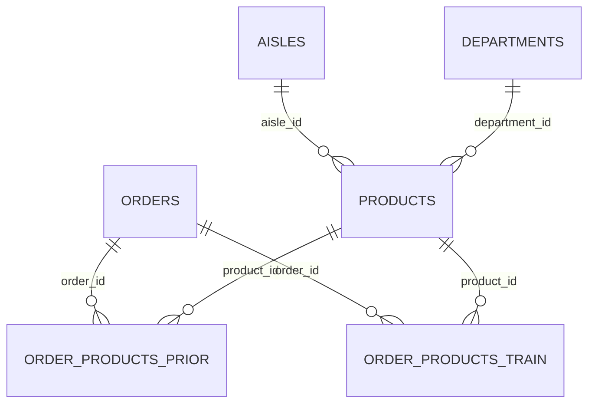

# CHƯƠNG 3: THU THẬP, GHÉP NỐI VÀ PHÂN TÍCH KHÁM PHÁ DỮ LIỆU

## 3.1. Mô tả nguồn gốc và cấu trúc tập dữ liệu đa tệp (Multi-file)

### 3.1.1. Nguồn gốc và bối cảnh dữ liệu

Nghiên cứu sử dụng bộ dữ liệu **Instacart Market Basket Analysis**, được nhóm tiếp cận qua Kaggle. Nguồn dữ liệu do Instacart công bố năm 2017, gồm lịch sử mua sắm tạp hóa trực tuyến đã ẩn danh của hơn 200.000 người dùng [@instacart2017]. Trong đề tài, dữ liệu được sử dụng để nghiên cứu cấu trúc giỏ hàng và đề xuất gợi ý mua kèm trong bối cảnh bán lẻ. Mẫu công bố đã qua chọn lọc, vì vậy không mặc nhiên đại diện cho toàn bộ khách hàng hoặc hành vi mua sắm trên thị trường.

Theo yêu cầu học phần, nhóm tiếp nhận phiên bản được giảng viên bổ sung nhiễu nhân tạo nhằm mô phỏng các vấn đề chất lượng dữ liệu. Các bảng có thể giữ nguyên số dòng nhưng xuất hiện giá trị thiếu, khoảng trắng hoặc biểu diễn không hợp lệ. Mục 3.1 giới thiệu nguồn, cấu trúc và phạm vi sử dụng; quy trình ghép nối, tối ưu bộ nhớ được trình bày tại Mục 3.2, còn phương pháp xử lý nhiễu và kết quả đối soát nằm ở Mục 3.3. Nhóm không sử dụng bản dữ liệu sạch gốc để điền hoặc sửa các giá trị bị nhiễu.

### 3.1.2. Quy mô và đơn vị quan sát của sáu tệp

Bộ dữ liệu gồm sáu tệp CSV có quan hệ thông qua các mã định danh. Bảng 3.1 trình bày kích thước và khóa của từng bảng theo kết quả kiểm toán nội bộ. Khóa chính và khóa ngoại ở đây mô tả các ràng buộc được kiểm tra bằng chương trình; bản thân định dạng CSV không tự thực thi các ràng buộc này.

**Bảng 3.1. Quy mô và đơn vị quan sát của sáu tệp dữ liệu**

| Bảng CSV | Số dòng | Số cột | Một dòng đại diện cho | Khóa chính |
|---|---:|---:|---|---|
| `aisles` | 134 | 2 | Một quầy/nhóm danh mục | `aisle_id` |
| `departments` | 21 | 2 | Một ngành hàng | `department_id` |
| `products` | 49.688 | 4 | Một sản phẩm | `product_id` |
| `orders` | 3.421.083 | 7 | Một đơn hàng | `order_id` |
| `order_products__prior` | 32.434.489 | 4 | Một sản phẩm trong một đơn lịch sử | (`order_id`, `product_id`) |
| `order_products__train` | 1.384.617 | 4 | Một sản phẩm trong một đơn thuộc train của nguồn | (`order_id`, `product_id`) |

*Nguồn: Nhóm tổng hợp từ báo cáo kiểm toán đầu vào; tên bảng trong bảng được lược bỏ phần mở rộng `.csv`.*

Tổng số dòng của sáu bảng là **37.290.032**, phản ánh quy mô lưu trữ ở nhiều cấp quan sát, không phải số giao dịch độc lập. Riêng `orders` có 206.209 người dùng. Hai bảng chi tiết chứa 33.819.106 cặp đơn–sản phẩm, thuộc 3.214.874 đơn prior và 131.209 đơn train. Ngoài ra, 75.000 đơn thuộc test của nguồn không có chi tiết sản phẩm đi kèm trong sáu tệp.

Cần phân biệt một đơn hàng với một dòng chi tiết: đơn chứa mười sản phẩm khác nhau tương ứng một dòng trong `orders` và mười dòng trong bảng chi tiết. Dữ liệu không có cột số lượng, nên số dòng của một giỏ biểu thị số sản phẩm khác nhau, không phải tổng số đơn vị hàng hóa được mua.

### 3.1.3. Các nhóm bảng và ý nghĩa thuộc tính

Về chức năng, dữ liệu gồm ba bảng danh mục (`aisles`, `departments`, `products`), một bảng đầu đơn (`orders`) và hai bảng chi tiết đơn. Cách tổ chức này tách thông tin mô tả sản phẩm khỏi các lần xuất hiện của sản phẩm trong giao dịch. Bảng 3.2 tóm tắt các trường theo nhóm để làm cơ sở xác định khóa ghép và biến phân tích.

**Bảng 3.2. Từ điển dữ liệu tóm tắt**

| Bảng | Trường | Ý nghĩa và miền nghiệp vụ |
|---|---|---|
| `aisles` | `aisle_id`; `aisle` | Mã quầy/nhóm danh mục và tên tương ứng |
| `departments` | `department_id`; `department` | Mã ngành hàng và tên tương ứng |
| `products` | `product_id`; `product_name` | Mã sản phẩm và tên sản phẩm |
| `products` | `aisle_id`; `department_id` | Hai khóa ngoại tới danh mục quầy và ngành hàng |
| `orders` | `order_id`; `user_id` | Mã đơn và mã người dùng; không có bảng người dùng riêng trong sáu tệp |
| `orders` | `eval_set` | Nhãn phân vùng nguồn: `prior`, `train`, `test`; không phải trạng thái xử lý đơn |
| `orders` | `order_number` | Thứ tự đơn trong lịch sử của cùng người dùng, bắt đầu từ 1 |
| `orders` | `order_dow`; `order_hour_of_day` | Mã ngày trong tuần 0–6 và giờ đặt đơn 0–23 |
| `orders` | `days_since_prior_order` | Khoảng cách với đơn trước, đơn vị ngày; bị chặn trên ở 30; đơn đầu thiếu theo thiết kế |
| Hai bảng chi tiết | `order_id`; `product_id` | Hai khóa ngoại, đồng thời tạo khóa ghép xác định một dòng chi tiết |
| Hai bảng chi tiết | `add_to_cart_order` | Vị trí sản phẩm được thêm vào giỏ của cùng đơn, bắt đầu từ 1 |
| Hai bảng chi tiết | `reordered` | 1 nếu người dùng đã mua sản phẩm trong một đơn trước đó, 0 nếu chưa |

*Nguồn: Nhóm tổng hợp từ schema của sáu CSV và từ điển dữ liệu do tác giả công bố; các miền trên mô tả ý nghĩa kỳ vọng, không khẳng định dữ liệu nhiễu đã hợp lệ.*

Các mã định danh mang ý nghĩa phân loại dù được biểu diễn bằng số. Tên gọi là thuộc tính mô tả, không thay thế mã khi ghép bảng. `reordered` không nhất thiết chỉ lần mua liền trước và không phải nhãn mục tiêu của bài toán hoàn thiện giỏ trong nghiên cứu. Nhóm cũng không tự gán tên thứ cho mã ngày 0–6 khi chưa xác nhận quy ước nguồn. Kiểu dữ liệu lưu trữ và lựa chọn tối ưu cho các trường được giải thích tại Mục 3.2.

### 3.1.4. Quan hệ liên bảng và nguyên tắc xác định đơn vị phân tích

Sơ đồ dưới thể hiện riêng cả hai bảng chi tiết. Một sản phẩm có thể xuất hiện trong nhiều đơn; một đơn có nhiều dòng sản phẩm. Quan hệ nhiều–nhiều giữa đơn và sản phẩm được biểu diễn thông qua các bảng chi tiết với khóa ghép `(order_id, product_id)`.

*Hình 3.1. Quan hệ giữa sáu bảng dữ liệu Instacart. Nguồn: Nhóm xây dựng từ schema và kết quả kiểm tra khóa. `ORDER_PRODUCTS_PRIOR` và `ORDER_PRODUCTS_TRAIN` tương ứng hai tệp chi tiết trong Bảng 3.1.*

Các đường nối thể hiện quan hệ một–nhiều: mỗi dòng chi tiết tham chiếu một đơn và một sản phẩm; mỗi sản phẩm tham chiếu một mã quầy và một mã ngành hàng. Sơ đồ cho phép một đơn không có dòng chi tiết trong một bảng cụ thể, phù hợp với cách phân chia prior/train/test. Không có cột `department_id` trong `aisles`, nên không giả định một liên kết trực tiếp giữa hai bảng này từ schema hiện có.

Khi ghép, bảng chi tiết là phía nhiều, còn các bảng được tra cứu phải có khóa duy nhất. Xác định đúng cấp quan sát giúp tránh nhân dòng do khóa bảng cha trùng hoặc lựa chọn sai khóa liên kết. Tên sản phẩm bị thiếu không làm mất định danh sản phẩm; tương tự, cùng mã quầy không có nghĩa hai dòng là cùng một sản phẩm.

### 3.1.5. Phạm vi sử dụng trong nghiên cứu

Theo thiết kế đã chốt ở Chương 1–2, bảng phân tích chính được xây dựng từ `order_products__train` và bốn bảng `orders`, `products`, `aisles`, `departments`. Đơn vị phân tích được giữ ở cấp cặp đơn–sản phẩm, với quy mô mục tiêu **1.384.617 dòng thuộc 131.209 giỏ**, đáp ứng yêu cầu trên một triệu dòng chi tiết của đề tài PRJ-08. Không sử dụng tổng số dòng sáu bảng hoặc số cặp ứng viên sinh thêm để chứng minh quy mô master.

Bảng prior được sử dụng cho kiểm toán và tổng hợp lịch sử theo khối, không nối dọc vào master train, không dùng để tạo đặc trưng hoặc luật cho bộ phân loại trong phạm vi hiện hành. Nhãn train của nguồn cũng không đồng nhất với tập huấn luyện mô hình: người dùng có giỏ train sẽ được chia tiếp thành reference, fit, validation và test theo phương pháp ở Chương 2. EDA định hướng mô hình chỉ sử dụng reference.

Bộ dữ liệu phù hợp để phân tích thành phần giỏ, đồng xuất hiện sản phẩm và đánh giá gợi ý ngoại tuyến. Do thiếu giá, lợi nhuận, số lượng mua và nhật ký hiển thị gợi ý, nghiên cứu không tính trực tiếp doanh thu hoặc tỷ lệ nhấp, cũng không xem kết quả ngoại tuyến là bằng chứng doanh thu thực tế tăng. Những giới hạn này định hướng cách diễn giải kết quả ở các chương tiếp theo.

<!-- GHI CHÚ BIÊN TẬP — không thuộc nội dung in:
1. Bản Markdown này dùng số mục/bảng/hình thủ công. Khi đưa vào QMD có đánh số tự động, bỏ số thủ công và chuyển sang label/caption theo cấu hình hiện có để tránh trùng số.
2. Khóa trích dẫn instacart2017 cần tồn tại trong thư mục tài liệu tham khảo của QMD. Nguồn xác minh: Jeremy Stanley (2017), “3 Million Instacart Orders, Open Sourced”, https://tech.instacart.com/3-million-instacart-orders-open-sourced-d40d29ead6f2 . Từ điển: https://gist.github.com/jeremystan/c3b39d947d9b88b3ccff3147dbcf6c6b . Thêm khóa riêng cho từ điển nếu quy tắc trích dẫn của bài yêu cầu.
3. Nguồn tải nhóm sử dụng: https://www.kaggle.com/datasets/psparks/instacart-market-basket-analysis . Phân biệt nguồn tải lại với đơn vị công bố ban đầu.
4. Khi chuyển sang Word, render sơ đồ thành hình, không in khối mã Mermaid. Bố trí sơ đồ gọn, khoảng 1/4 trang. Dự kiến 3–4,5 trang A4 với font 12–13, giãn dòng 1,3–1,5 và lề quy định; số trang cuối cần kiểm tra sau dàn trang. Không giảm font dưới chuẩn để ép trang.
-->
